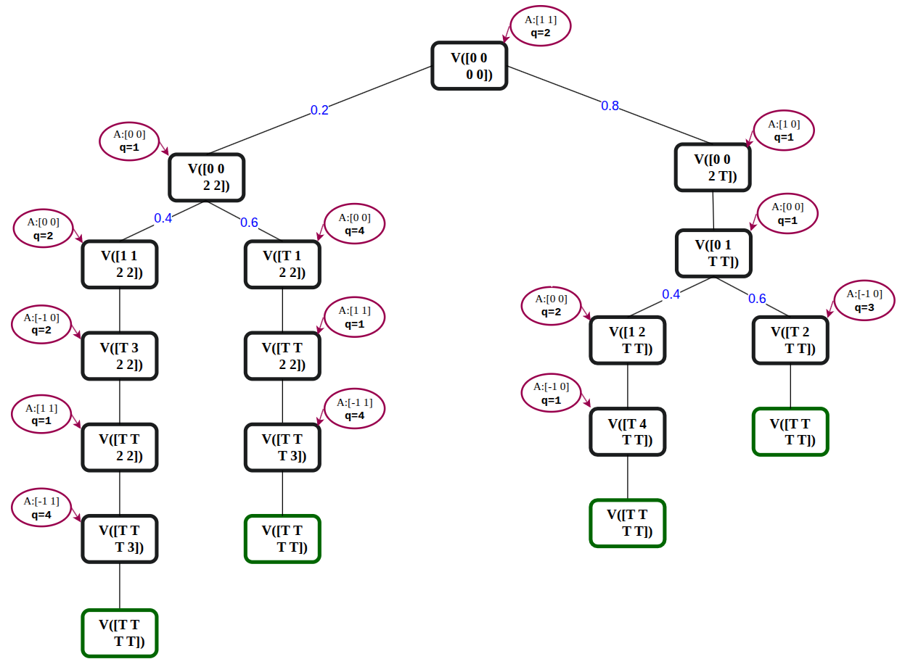

# Dynamic Concurrent Open Shop with Stochastic Processing Times

This repository holds the code for my PhD work on scheduling the **Concurrent Open Shop (COS)** problem when **processing times are random**. The problem is modelled as a **Markov Decision Process (MDP)**. I use it to compute optimal dynamic policies and to measure how well classical and index-based heuristics do against them.

The repository has two parts:

- **`COS/`**: the C++ engine (MDP solver, heuristics, instance generator, experiment scripts).
- **`Interface/`**: a PySide6 desktop app for launching runs, browsing results and plotting analyses. It is still in progress.

---

## 1. The problem

### Concurrent Open Shop

- There are $m$ machines and $N$ jobs. Each job $j$ has a weight $w_j$.
- Each job $j$ has one task $(j,i)$ per machine $i$. Its tasks are independent and can run **at the same time** on different machines.
- A job is **complete** only when **all** of its tasks are finished: $C_j = \max_i C_{ji}$.
- The objective is to minimise the **total weighted completion time** $\sum_j w_j C_j$.

The deterministic version is already NP-hard. It is also the abstract model behind **coflow scheduling** in data-center networks, where a coflow is a job and a network port is a machine.

### Stochastic setting

Here the processing time $P_{ji}$ of each task is a **random variable**. Only its distribution is known before scheduling. Two families are supported:

| Type | Definition | Notes |
|---|---|---|
| **Discrete** | $P_{ji}$ takes values $v_1 < v_2 < \dots$ with probabilities $p_1, p_2, \dots$ | Arbitrary support; the coefficient of variation (CV) can be controlled by the generator |
| **Geometric** | $\Pr(P = k) = \alpha(1-\alpha)^{k-1},\ k \ge 1$ | Memoryless; $E[P] = 1/\alpha$, CV $=\sqrt{1-\alpha} < 1$ |

The scheduler is **dynamic and non-anticipative**. At each decision point it sees what has been processed so far and which tasks have finished, but it never sees the realised durations in advance. Preemption is allowed at decision epochs.

### MDP formulation

- **State** `(Y, S)`: two $N \times m$ matrices. `Y[j][i]` is the processing already received by task $(j,i)$. `S[j][i]` is its current *phase*, with `-1` (shown as `T`) when the task is finished.
- **Phases**: each discrete distribution is broken into phases, one per support point (`JobTasksInPhase`). Phase $k$ stores a duration and a probability $\beta$ that the task is **not** finished at the end of that phase. A geometric task is a single phase of length 1 that loops back on itself.
- **Action** `A`: a vector of length $m$. `A[i]` is the job processed on machine $i$, or `-1` if the machine is idle. The quantum `q` is how long the action runs before the next decision.
- **Cost**: each time unit costs the total weight of the jobs that are not yet complete. The value of the initial state is therefore the expected total weighted completion time.
- **Solution**: Bellman recursion with memoisation (`ValueFunction` / `QFunction`). The self-loops created by geometric tasks are solved in closed form (`solveSelfLoop`).

Example of an optimal policy tree for 2 jobs × 2 machines. Each node is a state `V([Y])`, each edge is a probabilistic transition, and each bubble is the chosen action and quantum:



---

## 2. Algorithms

Every algorithm is identified by a one-letter code that is used throughout the executables and scripts:

| Code | Name | Description | Main file |
|---|---|---|---|
| `o` | **VI (optimal)** | Exact MDP value iteration over the restricted action space | `ValueIteration.cc` |
| `g` | **GitHeur (GIPP)** | Gittins Index Priority Policy adapted to COS (3 variants: per-machine, global min/max aggregation, global selection; variant 3 is the default) | `GitHeur.cc` |
| `s` | **Sincronia (dynamic)** | Sincronia's bottleneck-based ordering, using expected remaining processing times and recomputed at each decision epoch | `Sincronia.cc` |
| `t` | **Static** | Sincronia order computed once at time 0 and kept for the whole run | `Sincronia.cc` |

The heuristics are **evaluated exactly** in the same MDP (policy evaluation: `PolicyValueFunction_GIPP`, `PolicyValueFunction_Sincronia`), so their expected costs can be compared directly with the optimum.

**VI options**

- *Action generation* (`-g`):
  - `0` recursive: all job-to-machine assignments.
  - `1` order-based (default): actions induced by a priority order over the jobs.
  - `2` successive orders.
- *Allocation granularity* (`-l`):
  - `u` / `-1` unit: one time unit per decision.
  - `s` / `0` semi-phase (default).
  - `p` / `1` full phase.

### Two evaluation modes

1. **Stochastic (`exec_sto`)**: computes the exact expected value of the initial state under the full distributions.
2. **SAA, Sample Average Approximation (`exec_saa`)**:
   - Draws realisations of the processing times.
   - Runs each policy on the realisations. Decisions still use only the distributions; transitions follow the sampled durations.
   - Averages the costs in batches until the result stabilises (tolerance, number of stable batches).
   - Reports the mean, min, max, standard deviation and the number of samples used.

---

## 3. Repository structure

```
.
├── COS/                         # C++ core
│   ├── Job.hxx / Job.cc         # Task, Job, distributions (discrete / geometric), instance reader
│   ├── ValueIteration.hxx/.cc   # MDP: states, phases, actions, transitions, Bellman recursion, policy I/O
│   ├── GitHeur.hxx/.cc          # Gittins index computation + GIPP policies (M1, M2, M3) and their evaluation
│   ├── Sincronia.hxx/.cc        # Sincronia (dynamic) and static ordering + their evaluation
│   ├── Stochastic.hxx/.cc       # Dispatcher: stochasticValue(jobs, m, algo) + policy comparison with VI
│   ├── SAA.hxx/.cc              # Sampling of realisations and batched SAA estimation
│   ├── exec_sto.cc              # Main program: exact stochastic evaluation
│   ├── exec_saa.cc              # Main program: SAA evaluation
│   ├── JobsGenerator.cc         # Random instance generator (discrete with target CV, or geometric)
│   ├── jobsGeneratorInstances   # Script: generate a batch of instances
│   ├── jobsGeneratorInstancesInterface  # Script: generator entry point used by the Interface
│   ├── execution_sto            # Script: run exec_sto over N × m grids for one algorithm
│   ├── execution_saa            # Script: run exec_saa over N × m grids for one algorithm
│   ├── launches/
│   │   ├── launch_sto           # Compile + run execution_sto for several algos/instances
│   │   └── launch_saa           # Compile + run execution_saa for several algos/instances
│   └── Images/                  # Illustrations (VI and policy-evaluation trees)
│
└── Interface/                   # Python desktop GUI (PySide6), in progress
    ├── app.py                   # Entry point
    ├── launch.ipynb             # Notebook launcher
    ├── requirements.txt
    ├── core/                    # simulation_runner, file_manager, extractors, analyzers, plotting
    ├── models/                  # run_config, result_record dataclasses
    └── ui/                      # main_window + tabs: simulation, results, analysis, export
```

The folders `COS/Analysis/` (input instances and outputs), `COS/Plots/` and `COS/old_exec/` are local only and are not tracked (see `.gitignore`).

---

## 4. Getting started

### Requirements

- `g++` with C++17 (`<filesystem>`)
- Python ≥ 3.10 for the Interface (PySide6, matplotlib, numpy, pandas)

### Build

```bash
cd COS
g++ -O2 -std=c++17 JobsGenerator.cc Job.cc -o JobsGenerator
g++ -O2 -std=c++17 exec_sto.cc Stochastic.cc Sincronia.cc GitHeur.cc ValueIteration.cc Job.cc -o exec_sto
g++ -O2 -std=c++17 exec_saa.cc SAA.cc ValueIteration.cc GitHeur.cc Sincronia.cc Job.cc -o exec_saa
```

### Instance format

Each instance file has one job per line:

```
# id weight nbr_Task  id_task distribution  id_task distribution ...
0 1 2  0 3:0.400000 7:0.600000  1 2:1.000000      # discrete:  value:probability ...
1 1 2  0 0.524  1 0.310                           # geometric: alpha
```

All tasks in one instance must use the same distribution type.

### Generate instances

```bash
cd COS
# ./JobsGenerator <N> <m> <d> <INST_ID> <CV> <outputDir> [d|g]
./JobsGenerator 10 2 2 0001 0.0 ./Analysis/Inputs/Geo/N10_m2/ g
```

Or edit and run `./jobsGeneratorInstances` to generate a full grid of instances.

### Exact stochastic evaluation

```bash
# ./exec_sto [-a start] [-b end] [-l alloc] [-g genType] [-p] [-c policyDir] <N> <m> <algo> <d|g> <inputDir> <outputDir>
./exec_sto -a 0 -b 9 -l s -g 1 -p 10 2 o g ./Analysis/Inputs/Geo/N10_m2/ ./Analysis/Outputs/Geo/sto/order/N10_m2/
./exec_sto -a 0 -b 9 10 2 g g ./Analysis/Inputs/Geo/N10_m2/ ./Analysis/Outputs/Geo/sto/githeur/N10_m2/
```

- `-p` saves the VI policy.
- `-c <dir>` compares a heuristic decision by decision against a saved VI policy.

### SAA evaluation

```bash
# ./exec_saa [-a start] [-b end] <N> <m> <algo> <nbInstancesMax> <batchSize> <tolerance> <requiredStableBatches> <cv> <d|g> <inputDir> <outputDir>
./exec_saa -a 0 -b 0 2 2 g 1000 100 1e-3 3 0.0 g ./Analysis/Inputs/Geo/N2_m2/ ./Analysis/Outputs/Geo/saa/githeur/N2_m2/
```

### Batch experiments

```bash
cd COS/launches
./launch_sto     # compiles exec_sto, then calls ../execution_sto for each algo / instance
./launch_saa     # compiles exec_saa, then calls ../execution_saa
```

Edit the arrays `N=(...)`, `m=(...)` and the list of algorithms at the top of these scripts to choose the experimental grid.

### Outputs

For each run, `<outputDir>` contains:

| File | Content |
|---|---|
| `Results_N<N>_m<m>_<a>_<b>.txt` (or `Results_opt_…` for VI) | One line per instance: index, expected cost, execution time in ms. SAA files also include min / max / std / samples used. |
| `exec_<instance>.txt` | Detailed log: job description, final value, run time |
| `policy_<instance>.txt` | Saved VI policy (with `-p`) |
| `comparison_<instance>.txt` | Decision-by-decision comparison with VI (with `-c`) |

### Interface

```bash
cd Interface
pip install -r requirements.txt
python app.py
```

The GUI has four tabs: **Simulation**, **Results**, **Analysis** and **Export**. They are meant to launch the executables above, read the `Results_*.txt` files and compare algorithms with plots. The connection to the C++ executables (`core/simulation_runner.py`) is not finished yet.

---

## 5. Context

This code is part of my PhD thesis on **coflow scheduling under uncertainty**. The aims are to:

- compute **optimal dynamic policies** for small stochastic COS instances;
- measure the **optimality gap** of practical heuristics (Gittins-based, Sincronia, static orders);
- study how this gap depends on the **variability** of the processing times (CV), the **distribution type**, and the instance size $(N, m)$.

## Author

Aminata Sangho, PhD student
